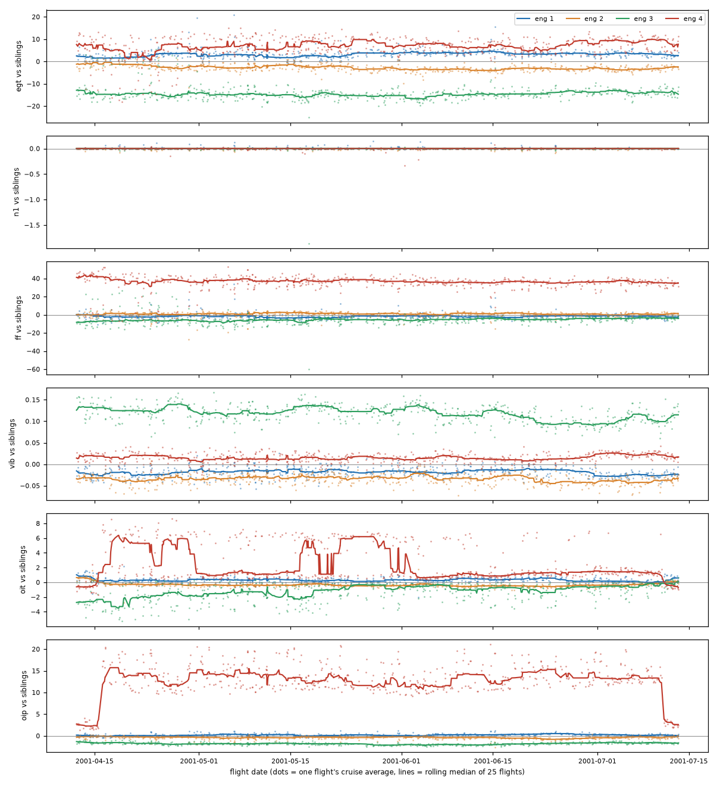

# Phase 2: anomaly detection on DASHlink tail 670

No labels exist for this data, so every method here is checked in two ways: against faults of known size injected into real flights, and by inspecting what it flags on the real flights.

## Approach

**Features** (`src/flighthealth/features.py`): one row per flight and phase (takeoff, climb, cruise, descent, approach, landing), from the cleaned 1 Hz table. 3,277 flight-phases from 548 full flights, 406 features each:

- mean, standard deviation, 5th and 95th percentile of each sensor channel (position, heading and crew-selected values left out)
- for each four-engine family (N1, N2, EGT, fuel flow, vibration, oil temperature, oil pressure, thrust lever): each engine's deviation from the median of the four, as mean and largest absolute value over the phase
- seconds each warning (master warning, GPWS, stick shaker/pusher, windshear, takeoff config) was active

**Detectors:**

| Detector | What it is |
|---|---|
| Limit rules (`exceedances.py`) | 13 rules in the style of airline flight-data monitoring: hard landing, sink rate and glideslope/localizer deviation below 1,000 ft, bank below 500 ft, pitch at takeoff/landing, peak EGT, N1 and EGT split, vibration, oil pressure and temperature in cruise. The aircraft's published limits aren't available, so each rule flags values beyond the fleet's 99.5th percentile. |
| Global PCA / isolation forest (`detect.py`) | One model per phase over all 406 features. PCA reports the total reconstruction error (`pca_sum`) and the error of the single worst channel (`pca_max`). |
| Engine PCA / isolation forest | Same models over only the 32 engine-vs-siblings features. |
| Sibling z-score | No model: the largest robust z-score among the engine-vs-siblings features. |
| Engine combined | Whichever of engine PCA (worst channel) and sibling z-score ranks more extreme. |

Features are scaled with the median and IQR, and z-scores are capped at ±10 when fitting and scoring, so near-constant features can't explode into noise.

## Fault injection (`scripts/eval_injection.py`)

Fit on 384 flights (70%). Into the cruise phase of each of the 164 held-out flights, inject one fault on one engine (chosen by a stable hash of the flight ID), rebuild that flight's features, and score. **Detection** = score above the 95th percentile of the same held-out flights without a fault, i.e. a 5% false-alarm rate. The limit rules run at 6.1% false alarms on the same flights. A **control** (nothing injected) stays at 5% for every detector, which confirms the evaluation itself doesn't leak.

Share of held-out flights detected at a 5% false-alarm rate:

| Injected fault | Size | Limit rules | Global PCA (sum) | Global PCA (worst channel) | Engine PCA (worst channel) | Sibling z | **Engine combined** |
|---|---|---|---|---|---|---|---|
| EGT offset | +10 °C | 6% | 5% | 5% | 55% | 5% | 48% |
| EGT offset | +20 °C | 6% | 13% | 27% | 99% | 6% | **99%** |
| EGT drift over cruise | 0 → 40 °C | 6% | 16% | 57% | 99% | 5% | **99%** |
| N1 offset | −0.25% | 6% | 23% | 13% | 63% | 100% | **98%** |
| N1 offset | −2% | 100% | 45% | 28% | 68% | 100% | **100%** |
| Oil pressure drop | −5 psi | 12% | 23% | 73% | 74% | 24% | **75%** |
| Oil pressure drop | −10 psi | 24% | 58% | 74% | 81% | 74% | **79%** |
| Oil temperature rise | +10 | 15% | 49% | 64% | 76% | 51% | **79%** |
| Vibration rise | +0.1 in/s | 30% | 18% | 39% | 83% | 5% | **80%** |
| Vibration rise | +0.2 in/s | 69% | 100% | 100% | 100% | 5% | **100%** |

Isolation forests (global and engine) stayed at 5–10% for every fault and are left out of the table. Full results: `reports/phase2/injection_detection.csv`.

What this shows:

1. **A whole-aircraft score drowns out a single-engine fault.** With 406 features, normal variation everywhere else outweighs one engine's change. The global models catch large faults only.
2. **Comparing each engine with its siblings is what works**, which matches how engine trend monitoring is done in industry. The engine-only PCA catches a 20 °C EGT offset 99% of the time; the limit rules catch it 6%.
3. **The two engine detectors cover each other's gaps.** N1 is held very tightly across engines, so a plain z-score catches a 0.25% N1 offset every time; EGT varies naturally between engines, and only the PCA, which learns how EGT moves with the other engine parameters, catches EGT faults. The combination is the best or close to the best on every fault.
4. **Localization:** engine PCA names the right engine channel 97–99% of the time for EGT faults of 20 °C or more, and the sibling z-score names the right engine for N1 offsets 98–100% of the time.
5. **Isolation forest doesn't suit this problem.** It scores how easy a point is to isolate in all dimensions at once, so one shifted feature among many barely changes it.

## On the real flights

**Global models (`reports/phase2/anomaly_scores.csv`).** The flight-phases both models rank in the top 1% have readable causes: speed brakes or spoilers deployed during climb, the airbrake used in cruise, unusual N2 patterns at takeoff. These are operationally unusual, not faults. The two global models only partly agree (rank correlation 0.46), and only 5 of the 32 flight-phases with a rule exceedance are in the models' top 5%: rules and models catch different things.

**Engine detector, cross-fitted (`reports/phase2/engine_scores_cruise.csv`).** Each flight is scored by a model fit on the other 80% of flights. The two flights tied at the top show two different things. One is a crew action: the engine 3 thrust lever is pulled back twice in cruise and every engine-3 parameter follows. The detector is right that engine 3 behaved differently; the cause just isn't the engine. Engine 3 also runs about 0.13 in/s higher vibration than its siblings on every flight. The other exposed a phase-rule weakness: on short flights, "cruise" can be a few minutes over the top of a climb and descent, not steady flight.

## Engine trends across flights

Plotting each engine's cruise deviation from its siblings over three months (`scripts/plot_trends.py`) shows persistent offsets (engine 3 runs 15 °C cooler and with higher vibration, engine 4 burns ~40 lb/h more fuel) and **two clean steps in engine 4 oil pressure**: from about +2 to +15 psi on 16 April, and back to +3 on 11 July.

`scripts/run_trends.py` finds steps automatically (median of 15 flights before vs after, at least 6× the series' flight-to-flight noise, then a least-squares split to place the step on the right flight) and lists the ground-only recordings just before each step.

| Step | First flight after | Ground runs just before |
|---|---|---|
| Engine 4 oil pressure +15 psi | 16 Apr 05:44 | Evening of 15 Apr: engines 1–3 run, **engine 4 stays off**. Overnight: two short engine-4 start attempts, then a run with **engine 4 at 96% N1**. |
| Engine 4 oil pressure −11 psi | 11 Jul 05:01 | 01:47–03:38: six short runs of **engine 4 alone, each to about 95% N1**. |
| Engine 4 oil temperature +7 | 16 Apr 05:44 | the same April ground runs |

Engine serial numbers never change, so no engine was swapped. Both oil-pressure steps follow overnight ground runs of engine 4 at near-full power, the usual pattern of maintenance on an engine followed by a run-up check. Only 10 of the 89 ground-only recordings reach 90% N1, so both steps landing right after engine-4 run-ups is very unlikely to be chance. **No maintenance log is available, so what was done can't be confirmed.**

The detector also finds **engine 4 oil temperature switching between two levels about 8 times between April and early June, with no ground runs nearby**. That looks like an operating mode (an oil-cooler valve, for example) or an intermittent sensor, not maintenance.

## Limitations

- The injected faults are simple shapes (offsets, linear drift) on one channel. Real faults move several parameters together and can develop over many flights.
- Limit-rule thresholds are fleet percentiles, not the aircraft's published limits.
- Because deviations are measured from the median of four engines, a large change on one engine slightly shifts the others' deviations.
- "Cruise" on short flights is not always steady flight. Engine trend monitoring in industry uses stable-cruise snapshots; adding that is the next improvement.
- One aircraft, three months. The trend findings are case studies, not statistics.

## Next

- Stable-cruise snapshots instead of whole-phase averages for engine features.
- Phase 3: run the same feature and detection approach on NGAFID and test whether scores separate flights before and after real maintenance events.
