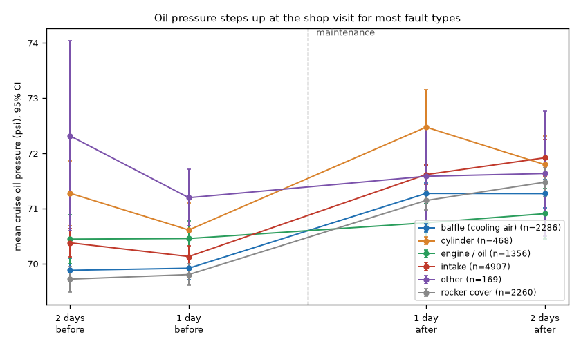

# Phase 3: validation against real maintenance events (NGAFID)

**Question:** do flight-data methods tell flights *before* an unplanned maintenance event (part failing) from flights *after* it (part repaired)?

**Short answer:** a gradient-boosted classifier on hand-built features matches the published deep-learning benchmark (76.3% vs 76.0% accuracy). But most of that accuracy comes from a **shop-visit effect, not the faults**: cruise oil pressure is about 1.3 psi higher after maintenance for almost every fault type, including ones that have nothing to do with the oil system. Without the oil channels, accuracy drops to 57%. The faults a health monitor most needs to catch (rough running, engine failure, overspeed) are at chance with every method.

## Data

NGAFID maintenance dataset, "2days" subset ([Yang & Desell 2022](https://arxiv.org/abs/2210.07317), CC-BY-4.0): 11,446 Cessna 172 flights, 23 channels at 1 Hz, within two days before (5,602) or after (5,844) one of 19 types of unplanned maintenance. No aircraft IDs or dates.

**Folds.** The authors' 5 folds are used throughout. Checked: they're stratified by fault type, and within each fault type they're contiguous blocks in index order, so most maintenance events stay inside one fold. An attempt to reconstruct event IDs from the header failed sanity checks (2,863 "events" against 2,111 in the full set; 581 with duplicate flight positions), so no event-paired analysis was done.

**Cleaning** (`src/flighthealth/ngafid.py`, rules in `config/ngafid_rules.csv`): the same native-rate checks as DASHlink. Main findings: fuel quantity reads 54 (above a 172's tank capacity) in about 5,300 stretches, now treated as missing; the battery ammeter has about 7,400 single-sample spikes; impossible CHT/EGT/vertical-speed values are removed. Nothing is filled in.

**Features**, one row per flight (358): per segment (ground run-up at 1,600–2,000 rpm, climb, cruise), the mean, standard deviation, 5th and 95th percentile of each channel, plus each **cylinder's CHT and EGT relative to the median of the four**, the same engine-vs-siblings idea that worked on DASHlink.

## A. Unsupervised: chance level

Models fit only on post-maintenance flights (repaired, so a "healthy" reference) from the training folds, scored on the held-out fold.

| Scores (cylinder-vs-siblings features) | ROC AUC, before vs after |
|---|---|
| PCA total error | 0.497 |
| PCA worst channel | 0.495 |
| Sibling z-score | 0.495 |

No fault type reaches 0.57. The dataset authors predicted that anomaly detection would be "extremely difficult" here, because pilot actions and weather swamp subtle part wear. That holds up.

## B. Supervised: matches the benchmark, mostly for the wrong reason

Histogram gradient boosting, authors' folds (paper's best: ConvMHSA 76.0%, InceptionTime 75.5%, MiniRocket 59.8%).

| Features | Count | Accuracy | AUC |
|---|---|---|---|
| All | 358 | **76.3%** ± 1.3 | 0.851 |
| Engine channels | 222 | 76.1% | 0.844 |
| **Oil pressure + oil temperature only** | 24 | **72.3%** | 0.797 |
| **Everything except oil** | 334 | **57.4%** | 0.603 |
| Cylinders vs siblings | 78 | 55.0% | 0.571 |
| Operational (speed, altitude, fuel, OAT, durations) | 88 | 53.0% | 0.542 |
| All, shuffled labels (control) | 358 | 49.7% | 0.497 |

The operational-only result rules out the most obvious confound (post-maintenance check flights flown differently), and the shuffled-label control rules out leakage in the evaluation itself.

**Permutation importance by channel** (`reports/phase3/channel_importance.csv`): shuffling oil pressure drops AUC by 0.31. The next channels: oil temperature 0.05, cylinder CHT deviations 0.02, EGT deviations 0.02, battery ammeter 0.01.

## The shop-visit effect

| | 2 days before | 1 day before | 1 day after | 2 days after |
|---|---|---|---|---|
| Mean cruise oil pressure (psi) | 70.2 | 70.1 | 71.4 | 71.6 |

The step sits exactly at the maintenance date and holds after it. It appears for baffle screws, ties, seals and rivets (cooling-air parts), intake gaskets and rocker covers alike. The most likely cause is an oil change or top-up during the shop visit; this can't be confirmed because the maintenance text is withheld.

**Per fault type** (`reports/phase3/auc_vs_oil_step.csv`), the classifier's AUC tracks the size of the oil step (Spearman 0.56, p = 0.013, 19 types):

| Fault type | Oil step (psi) | AUC, all features | AUC, without oil |
|---|---|---|---|
| Engine idle/rpm issue | −0.56 | 0.57 | 0.54 |
| Pilot/in-flight noticed issue | −0.11 | 0.43 | 0.49 |
| **Engine run rough** | −0.11 | **0.53** | 0.52 |
| Engine failure/fire/time out | +0.37 | 0.56 | 0.55 |
| Engine/propeller overspeed | +0.59 | 0.49 | 0.51 |
| Cylinder compression issue | +0.95 | 0.88 | 0.66 |
| Cylinder crack/fail | +1.05 | 0.78 | 0.67 |
| Rocker cover leak | +1.34 | 0.89 | 0.60 |
| Intake gasket leak | +1.44 | 0.88 | 0.62 |
| Baffle seal loose/damage | +1.73 | 0.87 | 0.56 |

Every fault type with an oil step of 0.8 psi or more scores AUC 0.78–0.90; every type with a step of 0.6 psi or less scores 0.43–0.75. "Engine run rough" should be the easiest fault to see in engine data, and it is at chance.

**Early detection.** The paper reports equal accuracy one to five flights before maintenance and reads it as early detection. The same flat pattern appears here (recall 76.5% on the last flight before, 73.8% five flights before). A flat curve is what a pre-service vs post-service signal would produce; a wearing part should get easier to detect closer to the repair.

## What real fault signal is left

Without the oil channels, AUC is 0.60 overall. The cylinder-vs-siblings features alone do best on the faults where physics says they should: cylinder crack/fail (0.65), oil cooler (0.63), cylinder compression (0.61), engine run rough (0.62). The signal is weak, but it's in the right places.

## Implications

- A before/after classifier on this dataset mostly learns "has this aircraft been serviced since", and the benchmark's 76% likely includes the same effect. (I didn't rerun the authors' deep models; their inputs include oil pressure.) A fairer benchmark would remove channels that maintenance itself changes, or compare against flights before and after **routine** shop visits.
- The same lesson showed up in Phase 2 from the other direction: on DASHlink, engine 4 oil pressure stepped at each maintenance visit. **Oil pressure is a strong maintenance-visit detector** in both datasets. That's useful for reconstructing maintenance history from flight data, and a trap for anyone training fault classifiers.

## Limitations

- Whole-flight summary features, not the raw sequences the deep models use. Matching their accuracy suggests the features capture what matters for this label, but sequence models could find signal I don't.
- The oil-service explanation is inferred, not confirmed.
- No aircraft IDs: an aircraft can appear in training and test folds through different maintenance events.
- "2days" subset only; the full 4.3 GB set has more flights per event.
